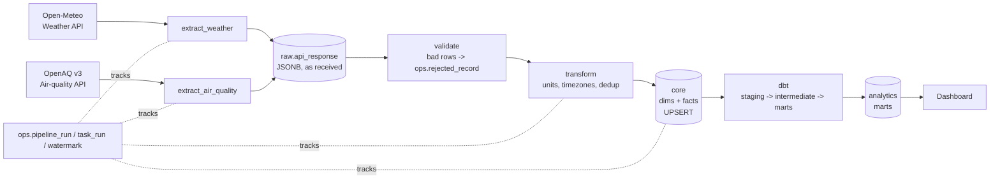
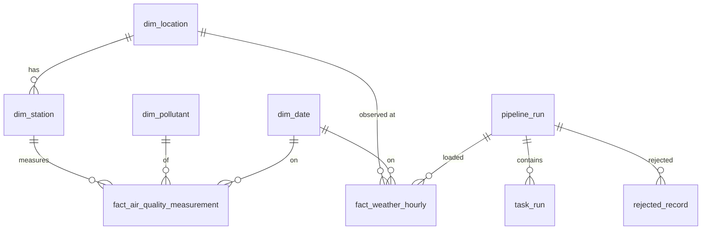

# Architecture & Design Decisions (Phase 1)

## 1. Data flow

Airflow runs the chain. The two extracts run **in parallel**, not one after the other —
they don't depend on each other, so making them sequential only slows the run.

## 2. Database layers

| Schema | Written by | Purpose |
|---|---|---|
| `raw` | Python extract | API responses exactly as received. Lets us re-process without re-calling the API. |
| `core` | Python load | Validated dimensions and facts. DB constraints are the last line of defence. |
| `ops` | Every task | Run logs, row counts, watermarks, rejected rows. |
| `analytics` | dbt (Phase 12) | Business-ready marts. |

## 3. Schema

**Fact grains**
- `fact_weather_hourly`: one row per location, per UTC hour, per source.
- `fact_air_quality_measurement`: one row per station, per pollutant, per UTC hour.

## 4. Decisions (and what was rejected)

**D1 — Weather source: Open-Meteo.** No API key, hourly data, historical archive for backfill.
Downside: it's model data on a grid, not a real weather station.

**D2 — Air-quality source: OpenAQ v3 (primary), Open-Meteo Air Quality (fallback).**
OpenAQ gives real station readings and needs real engineering work: API key, pagination,
rate limits (60/min, 2,000/hour on the free key), stations going offline, mixed units.
That is the point of the project. Open-Meteo AQ is cleaner but is model output (CAMS), so
"which station is worst" questions would be fake. If OpenAQ coverage for a city is too
thin, that city falls back to Open-Meteo as a `model_grid` station — the schema already
supports this.

**D3 — Air quality stored long, not wide.** Spec asked for `pm25, pm10, no2...` columns.
Rejected for the core table: APIs return one value per sensor per pollutant, stations
measure different subsets, and a new pollutant would need `ALTER TABLE`. dbt pivots to
wide for analysis.

**D4 — AQI is derived, not stored in the fact.** AQI is a formula applied to
concentrations, and the formula differs by country (US EPA, UK DAQI, India NAQI). OpenAQ
does not supply AQI. Computing it in dbt means a formula fix is a rebuild, not a reload.
Honesty note: official US AQI for PM2.5 uses a 24-hour average (or NowCast). Our hourly
value is an "hourly AQI-equivalent" and will be labelled as such.

**D5 — `dim_station` added.** The spec put air quality at city level. Measurements happen
at stations; a city has several. Averaging to city is a modelling step done in dbt.

**D6 — Season is not in `dim_date`.** Seasons depend on place. UK winter is Dec–Feb;
North India's worst pollution is post-monsoon/winter (Oct–Jan). A single season column
would be wrong for half the cities. `dim_location.climate_zone` drives the mapping in dbt.

**D7 — Store UTC, report local.** All timestamps are `TIMESTAMPTZ` in UTC. `local_hour` and
`date_key` use the city's local time, because "AQI by hour of day" means local hour —
Delhi 08:00 is 02:30 UTC.

**D8 — Watermark per source per entity.** One global watermark would skip a failed city's
data forever once other cities succeed. Watermarks only move forward (`GREATEST`).

**D9 — Idempotency at three levels.** Raw: unique on (source, endpoint, entity, payload hash) — entity added in Phase 3b, see §9. Core: unique natural
keys + `ON CONFLICT DO UPDATE`. Dimensions: upsert only when values actually changed.

**D10 — No Kafka/Spark.** Volume: 5 cities × 24 h × ~6 pollutants × a few stations ≈ a few
thousand rows a day. PostgreSQL handles this comfortably.

## 5. Cities

London, Manchester, Birmingham (UK) and Delhi, Mumbai (India). The mix is deliberate:
UK cities give low-pollution, temperate patterns; Delhi gives extreme PM2.5 and strong
seasonality. Without that contrast, most of the business questions have boring answers.

## 6. Known risks

- OpenAQ coverage per city is uneven and must be checked in Phase 3 before committing.
- Monthly/seasonal questions need months of data. A live pipeline started today has
  none, so a **historical backfill** (Phase 7) is required, not optional.
- 5 cities is too few to claim "rainfall reduces PM2.5" in general. Results will be
  reported as associations within this sample, not causes.

## 7. Phase 2 — Extract layer decisions

**E1 — One request per city, not one multi-city request.** Open-Meteo accepts many
coordinates in one call, but then one bad city fails the whole call. Per-city requests
isolate failures; at 5 cities the extra calls are irrelevant (limit: 600/min, 10,000/day).

**E2 — Archive vs forecast endpoint.** Days older than 5 days → archive (ERA5 reanalysis,
stable). Newer → forecast endpoint (model output, may be revised). Windows crossing the
cutoff are split into two requests with no gap and no overlap.
*Open issue for Phase 7:* recent "forecast" values are provisional. A lookback re-fetch
lets the stable archive values overwrite them via UPSERT.

**E3 — Future hours are a trap.** The forecast endpoint returns all 24 hours of today,
including hours that haven't happened. The extractor never asks for future *days*;
Phase 4 transform drops any hour later than the extraction time.

**E4 — Retry only what can succeed.** Retry: timeouts, connection errors, 429, 5xx.
Never retry other 4xx. Exponential backoff (1, 2, 4 s + jitter, capped) and obey
`Retry-After`.

**E5 — Always store what the server sent, then validate.** Error bodies, invalid JSON
and schema-changed payloads all land in `raw.api_response`. Debugging starts from evidence.

**E6 — Fail loudly, but after saving the others.** If Delhi fails, London's data is
committed first, the task is marked `partial`, then an error is raised so Airflow
retries. The retry is safe because identical payloads are de-duplicated.

**E7 — Dedup hash ignores `generationtime_ms`.** That field changes on every call; hashing
it would make every re-fetch look new.

## 8. Phase 3a — Station discovery

OpenAQ is organised as location → sensors (one per pollutant) → measurements. You can't
ask for "PM2.5 in London"; you find locations near London, then pull their PM2.5 sensor.
`python main.py discover-stations` does the finding and writes `config/stations.yaml`,
which the Phase 3b extractor reads. The file is committed so station choices are
reviewable and reproducible.

**Selection rules** (each one is a unit test):
1. Drop mobile sensors, stations with no data in the last 7 days, and stations measuring
   none of PM2.5, PM10, NO2, SO2, O3, CO.
2. Prefer reference monitors over low-cost sensors, then stations with PM2.5, then nearest.
3. Keep up to 3 per city. A city uses OpenAQ only if a kept station has active PM2.5;
   otherwise it falls back to Open-Meteo air quality (decision D2).

**Defensive checks:** OpenAQ's docs disagree with themselves on coordinate order
(text says lat,lon; one example shows lon,lat). We send lat,lon and fail if any returned
station is more than radius + 5 km away. `meta.found` can be a string like ">1000", so
pagination stops on a short page, with a hard cap of 20 pages.

**Live result (4 Nov 2026):** all 5 cities have active PM2.5 in OpenAQ, but Manchester and
Birmingham only via low-cost AirGradient sensors. Their government (AURN/EEA) monitors are
listed in OpenAQ but were last updated 26–28 May 2026, so the 7-day rule rejected them.
OpenAQ also lists some stations twice (same name and code, different location IDs).

## 9. Phase 3b/3c — Air-quality extraction (decision B)

Mixed instruments make cross-city comparison unfair, and one source silently stopped
updating for months. So there are two air-quality sources:

| Source | Role | Covers |
|---|---|---|
| Open-Meteo Air Quality (CAMS model) | **Consistent baseline** — city rankings use this | all 5 cities, same method |
| OpenAQ (measurements) | **Ground truth where available** — modelled-vs-measured analysis | stations in `config/stations.yaml` |

**Shared Open-Meteo code.** Weather and air quality differ only in URL, variables and
expected units, so both are an `OpenMeteoSpec` run by one extraction loop (`open_meteo.py`).

**OpenAQ extractor.** One target per sensor from `stations.yaml`; `/v3/sensors/{id}/hours`
with whole-UTC-day windows; pagination; failure isolation per station. If a sensor returns
a different pollutant than the config says, it fails with "re-run discover-stations".

**Unit symbols.** "µ" (micro sign) and "μ" (Greek mu) look identical but are different
characters. Unit checks normalise them.

**Bug found and fixed:** raw dedup originally keyed on (source, endpoint, hash). OpenAQ hourly
results carry no sensor id, so two sensors with identical bodies (commonly: both empty)
collided and the second was silently dropped. Fix: add `entity_key` to the unique index
(`ux_api_response_dedup_v2`, `NULLS NOT DISTINCT`). Existing databases upgrade via `init-db`.

**Honest caveat.** CAMS is a model: ~11 km in Europe; India comes from the coarser global
model. Low-cost sensor readings are less reliable than reference monitors. Marts must keep
`station_type` so comparisons can be filtered.
